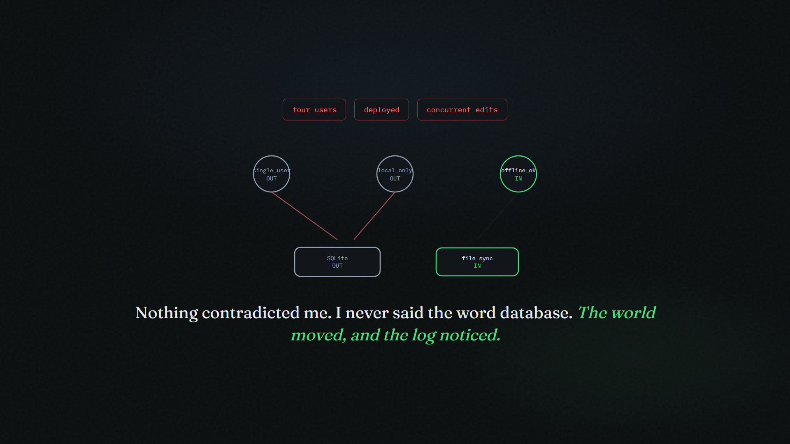
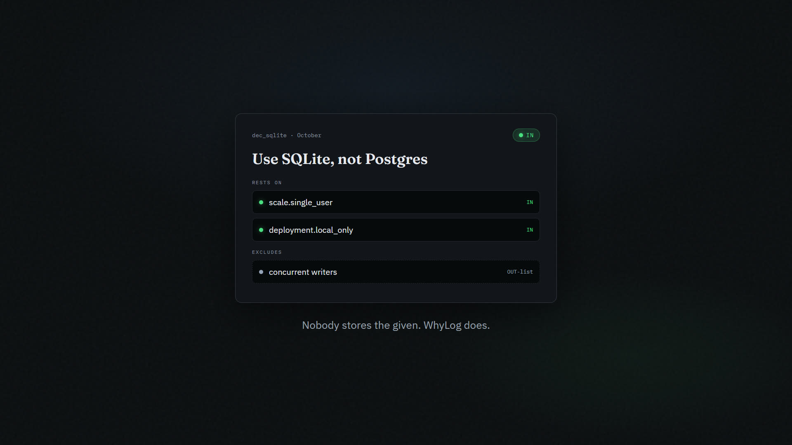
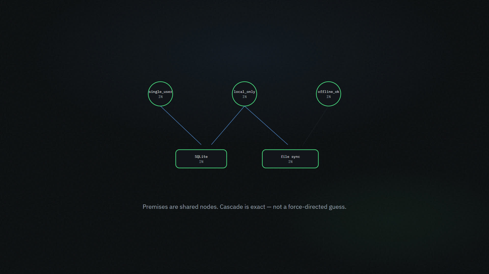
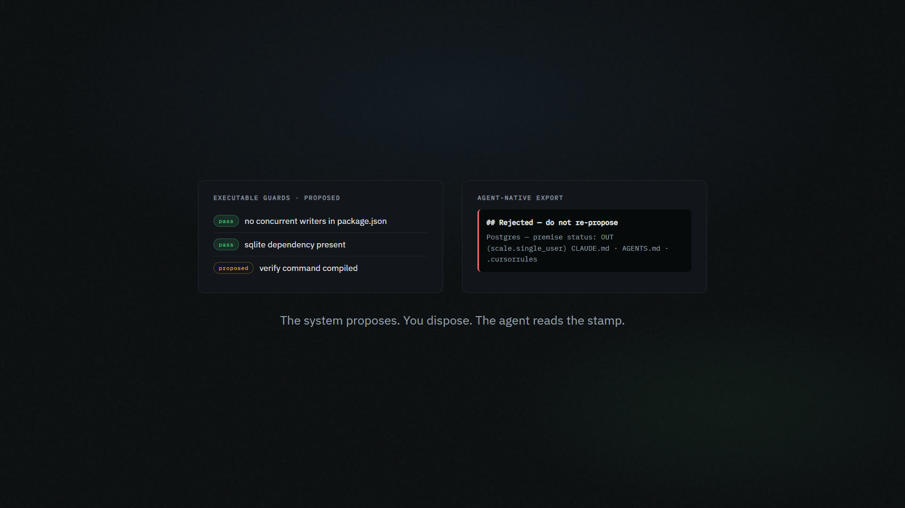
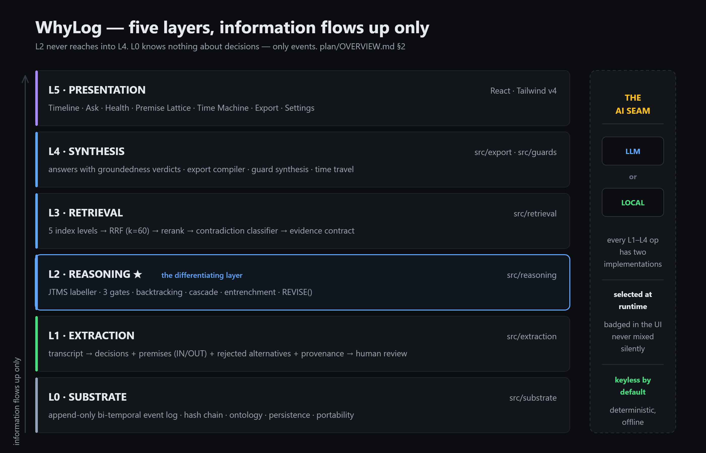

<p align="center">
  
</p>

<p align="center">
  <strong>Decision truth maintenance for AI coding.</strong><br />
  Not “what did we decide?” — <em>is what we decided still true?</em>
</p>

<p align="center">
  
  &nbsp;
  <a href="LICENSE"></a>
  &nbsp;
  
  &nbsp;
  
</p>

---

<p align="center">
  <video src="media/whylog.mp4" poster="media/poster.jpg" controls playsinline preload="metadata" width="920">
    <a href="media/whylog.mp4"></a>
  </video>
</p>

<p align="center">
  <a href="media/whylog.mp4"><strong>▶ 60-second film</strong></a>
  · 1920×1080 · <a href="brag-output/share-copy.txt">share copy</a>
</p>

---

## The gap

Your coding agent forgets every decision ten prompts back — so people built it a **memory**.

Memory isn’t the hard part.

A decision is not a fact. It is a belief held under assumptions about the world:

> *“SQLite, not Postgres”* is not true simpliciter. It is true **given** single-user, no deploy infrastructure, no concurrent writers.

Nobody stores the *given*. And the *given* is exactly what changes. You add a second user — nothing contradicts you, no new decision is logged — and the SQLite choice silently stops being true while every tool in the market keeps serving it back to your agent.

**Decision logs exist. None of them can tell you a decision has stopped being true.**

WhyLog is the immune system for that failure mode: it stores premises, notices when the world moves, cascades only the decisions that shared those premises, and proposes a minimal revision you must approve.

**Memory tools stop you repeating yourself. WhyLog stops you building on a decision that stopped being true three weeks ago.**

---

## What you get

| | |
|:---|:---|
| **Premises + OUT-list** | Every decision stores what it rests on *and* what would falsify it — shared nodes, not per-card strings. |
| **Gate (c) premise invalidation** | Fires when reality changes and nobody contradicted you. Contradiction detection is table stakes; this is the product. |
| **Exact cascade** | Only decisions sharing a falsified premise flip. Independent support stops the cascade. |
| **Executable guards** | Decisions compile into checks — proposed, never auto-installed. |
| **Agent-native export** | One graph → `CLAUDE.md` · `AGENTS.md` · `.cursorrules` with verify commands and a **Rejected — do not re-propose** block. |
| **Keyless by default** | Local engine is the default, not a fallback. Optional LLM for recall and phrasing. |

---

## Product in three beats

<p align="center"></p>

<p align="center"><sub><b>1 — Capture the given.</b> Paste a transcript. Review before anything enters the log. Premises and the OUT-list are first-class.</sub></p>

<p align="center"></p>

<p align="center"><sub><b>2 — See the lattice.</b> Premises as load-bearing nodes; decisions hang below. Deterministic layout — same graph, same picture.</sub></p>

<p align="center"></p>

<p align="center"><sub><b>3 — The world moves. The log notices.</b> Four users, deployed, concurrent edits — no one said “database.” Premises go OUT. Cascade fires. Unrelated decisions stay IN.</sub></p>

> *Nothing contradicted me. I never said the word database. The world moved, and the log noticed.*

<p align="center"></p>

<p align="center"><sub><b>Close the loop.</b> Guards proposed for approval. Exports your agent actually reads — stamped, with rejected alternatives so they are not re-proposed.</sub></p>

---

## Quick start

```bash
node --version          # ≥ 20.11  (see .nvmrc)
npm install
npm run dev             # http://localhost:5173 — keyless by default
```

In the app: **load demo** (header) → walk Import → Reasoning → Lattice → Guards → Export.

No API key is required. Optional providers live in [`.env.example`](.env.example); keys stay in `localStorage` and never reach the event log or an export.

| Command | Purpose |
|---|---|
| `npm run dev` | UI on `0.0.0.0:5173` |
| `npm run check:structure` | Structural verifier (Python only — no `node_modules` needed) |
| `npm run verify` | Typecheck + Biome + structure + tests |
| `npm run demo:verify` | Scripted demo beats + dry runs |
| `npm run eval` | DecisionMemEval baseline (local engine, offline) |
| `npm run eval:report` | Writes `docs/generated/EVAL-REPORT.md` |

---

## Architecture

<p align="center"></p>

| Layer | Role |
|---|---|
| **L5 Presentation** | Timeline · Ask · Health · Premise lattice · Time machine · Export |
| **L4 Synthesis** | Evidence verdicts · export compiler · guard synthesis |
| **L3 Retrieval** | Multi-level index → RRF → rerank → evidence contract |
| **L2 Reasoning ★** | JTMS · three gates · backtracking · cascade · entrenchment |
| **L1 Extraction** | Transcript → decisions + premises + OUT-list + alternatives |
| **L0 Substrate** | Append-only bi-temporal event log · hash chain · ontology |

The AI seam is vertical: every L1–L4 operation has a **local** and an **LLM** implementation, selected at runtime, badged, never mixed silently. Gates (a) and (c), cascade, and entrenchment are deterministic and engine-independent.

Full detail: [`ARCHITECTURE.md`](ARCHITECTURE.md) · [`plan/OVERVIEW.md`](plan/OVERVIEW.md).

---

## Four invariants

A module that violates one is wrong, not clever.

1. **Nothing is deleted.** Nodes are relabelled; every transition is an immutable event with a reason.
2. **Premises are shared nodes.** `"single-user"` is one node many decisions point at — that is what makes cascade exact.
3. **Retrieval proposes; a classifier disposes.** Cosine similarity never produces a verdict.
4. **The system proposes; the human disposes.** No auto-applied retraction, guard, or export.

---

## Positioning (precise)

| Commodity | WhyLog |
|---|---|
| Paste transcript → decisions | Stores **shared premises** and an **OUT-list** |
| Contradiction when *you* flip-flop | **Premise invalidation** when the *world* moves |
| Memory / ADR export | Cascade + minimal revision proposals + human gate |
| Hand-written fitness checks | **Guards compiled** from decisions |
| Q&A with citations | **Evidence contract** (grounded / partial / insufficient) + live premise labels |

Metaphor: **immune system, not memory.** Memory records what happened; an immune system notices that something which used to be safe no longer is.

Novelty audit and judge Q&A: [`docs/07-novelty-audit-and-positioning.md`](docs/07-novelty-audit-and-positioning.md).

---

## Status

Source-complete across Phases 0–7 · **274 source files** · structurally verified (`npm run check:structure`).

Eval numbers are produced by `npm run eval:report` — they are not invented here. Read [`LIMITATIONS.md`](LIMITATIONS.md) first if you are evaluating the work; it states what the repository does and does not establish.

| | |
|---|---|
| Research · theory · ontology | [`docs/`](docs/) · [`THEORY.md`](THEORY.md) · [`ONTOLOGY.md`](ONTOLOGY.md) |
| Evaluation design | [`EVALUATION.md`](EVALUATION.md) |
| File map | [`STRUCTURE.md`](STRUCTURE.md) |
| Pitch materials | [`pitch/`](pitch/) |
| Demo fixtures | [`fixtures/demo-transcript.txt`](fixtures/demo-transcript.txt) · [`fixtures/demo-transcript-2.txt`](fixtures/demo-transcript-2.txt) |

---

## License

[MIT](LICENSE)
